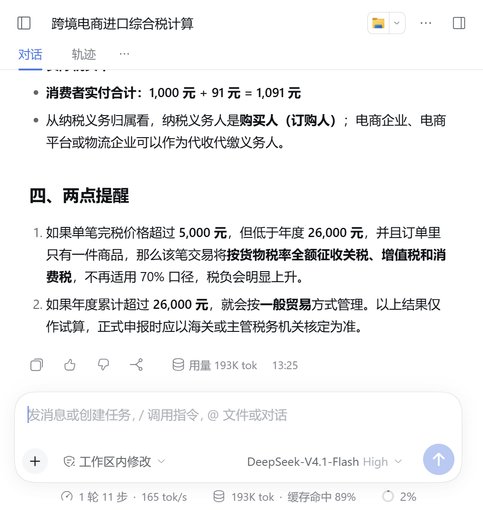
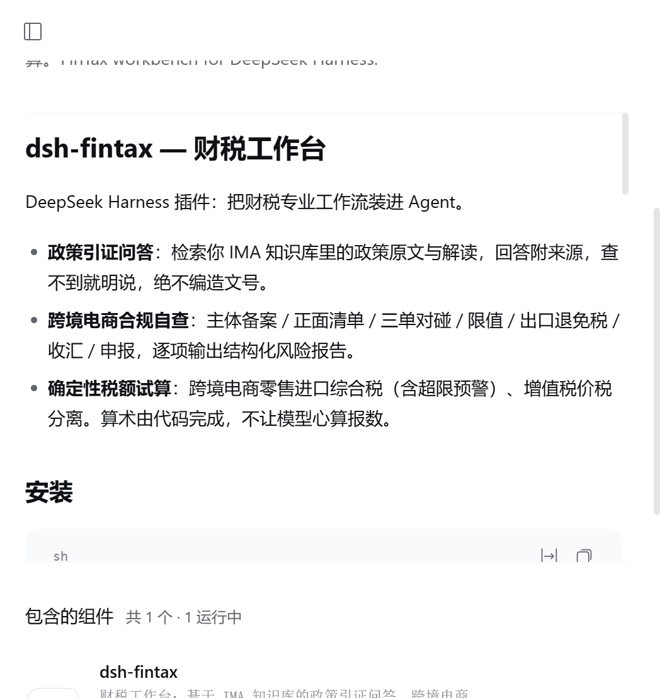

# dsh-fintax — 财税工作台 (v0.4.1)

[](https://www.npmjs.com/package/dsh-fintax)
[](LICENSE)
[](https://github.com/topics/dsh-plugin)


DeepSeek Harness 插件：把**跨境平台原始账单离线体检**、**IMA 专业政策引证问答**与**代码级确定性算税对账**装进桌面工作台。纯 ESM 零第三方依赖（免装 Python / LibreOffice），开箱即用。

- **原始结算账单离线初筛体检与异常雷达（`fintax_parse_statement`，v0.4 重磅新增）**：
  - 直接读取官方原样导出的 **Amazon**（Date Range CSV 多语种自动跳表头 / Flat File V2）、**TikTok Shop**（Statements 多表 `.xlsx` / `.csv`）、**Stripe 独立站**（余额流水 `.csv` / `.xlsx`）；
  - 纯原生 `BigInt` 定点运算精确到 `0.01` 分，自动剥离 `Marketplace Withheld Tax`（商城代扣流转税）、校验每一行水平守恒、拆解商家折扣 vs 平台补贴 vs 达人佣金，并扫描 **TikTok 全托管混表 P0 阻断、Stripe 虚拟卡直付广告防坐支、未捕获废单、A-to-z 拒付争议** 等高危异常；原始订单行仅在本机内存聚合，绝不外传。
- **桌面端图形化配置页**：打开 DSH **「设置 → 财税工作台」** 免命令行粘贴保存腾讯 IMA 凭证、一键测试连接并绑定**默认优先财税知识库**。
- **7 大代码级确定性算税与差额桥接引擎（`fintax_calc`，免配 IMA 亦可离线使用）**：
  1. **平台涉税报送四层口径差额桥接（`platform_tax_reconcile`）**：拆解平台报送总额 vs 结算实际放款 vs 增值税已申报额，自动排雷「拿回款净额报税、佣金违规冲减收入」；
  2. **供应商开票加点毛利临界测算（`export_invoice_breakeven`）**：精算「加税点拿专票退税」vs「综试区/1039合规无票免税」盈亏临界加点率 $g^*$ 及企业所得税联动净利对比；
  3. **综试区零售出口 4% 核定征收企业所得税（`cbec_assessed_cit`）**：含 **7,500 万营收（300 万所得额）5 倍税负悬崖**及 9810 核定口径收紧预警；
  4. **外贸企业出口免退税（`export_rebate`）**：孰低规则、征退税率差转成本、2026 年第 11 号公告第六/七条区分；
  5. **全年一次性奖金单独计税个税（`annual_bonus_iit`）**：含全档位「多发一元到手反少几千」临界陷阱检测；
  6. **跨境电商零售进口综合税（`cross_border_import`）**：限额内 0 关税 + 70% 折算、消费税组成计税价格与超限预警；
  7. **增值税价税分离（`vat`）**。
- **政策引证问答 & 监管代码决策树**：只读检索你 IMA 知识库里的政策原文与 SOP，回答附真实来源与文号。

## 实测效果

真实模型端到端测试：Agent 自动检索知识库 → 核对政策原文 → 调用确定性引擎计算 → 输出带引证的完整回答：



插件页安装状态：



## 安装

```sh
# 从 npm（推荐，预构建免授权）
dsh plugin --profile <你的profile> add dsh-fintax

# 从 GitHub
dsh plugin --profile <你的profile> add github:fleekelon/dsh-fintax

# 本地目录
dsh plugin --profile <你的profile> add /path/to/dsh-fintax
```

兼容 DSH >= 0.2.1-rc.2。

## 配置 IMA 知识库（可选，支持图形界面一键配置）

原始账单离线体检（`fintax_parse_statement`）与 7 大算税对账场景（`fintax_calc`）**无需任何凭证即可离线运行**。如需启用腾讯 IMA 知识库政策引证问答：

1. 打开 <https://ima.qq.com/agent-interface> 获取 `Client ID` 与 `API Key`；
2. **推荐方式（图形界面）**：在 DSH 桌面端打开 **「设置 → 财税工作台」**，粘贴保存凭证，点击「测试连接并拉取知识库」即可点选绑定你的默认财税知识库；
3. **CLI / 环境变量方式**：写入 `~/.config/ima/client_id` 与 `~/.config/ima/api_key`（可选 `~/.config/ima/fintax_config.json`），或设置环境变量 `IMA_CLIENT_ID` / `IMA_API_KEY` / `IMA_DEFAULT_KB_ID`。

安全承诺：设置页接口逐请求执行宿主会话准入校验（`connection.admit`），密钥只写不回传明文，且仅作为请求头发送至官方 `https://ima.qq.com`（严格只读）；`fintax_parse_statement` 仅在本机离线读取用户指定的账单文件。

## 工具与技能

| 工具 | 用途 |
|---|---|
| `fintax_parse_statement` | 本地离线解析 Amazon / TikTok Shop / Stripe 原始结算账单（CSV/TSV/XLSX），输出四层口径初筛体检单与 P0/P1/P2 异常雷达 |
| `fintax_calc` | 7 场景确定性试算与对账：`platform_tax_reconcile` / `export_invoice_breakeven` / `cbec_assessed_cit` / `export_rebate` / `annual_bonus_iit` / `cross_border_import` / `vat` |
| `ima_list_kbs` | 列出你的 IMA 知识库并标识已绑定的默认优先库 |
| `ima_search` | 在默认或指定知识库内搜索政策原文与底稿 |
| `ima_browse` | 浏览默认或指定知识库目录及展开子文件夹 |
| `ima_read` | 按 `media_id` 读取 Markdown / 笔记原文 |

| 技能 | 触发场景 |
|---|---|
| `fintax-calc` | 原始账单离线体检、税额试算与四层口径差额桥接工作流 |
| `fintax-policy-qa` | 政策引证问答（新旧文件优先级 + 降级路径） |
| `fintax-crossborder-check` | 跨境电商全链路合规自查报告（对齐 2026 现行法规） |
| `fintax-mode-select` | 海关监管代码与出口模式决策树 |

## 免责声明

本插件输出为财税初筛体检、算术试算与研究辅助，不构成正式关账底稿、税务申报依据或鉴证意见。企业月末正式关账与历史差异更正请结合多店铺完整底稿咨询执业税务师/律师，并以主管税务机关口径为准。

## License

MIT
