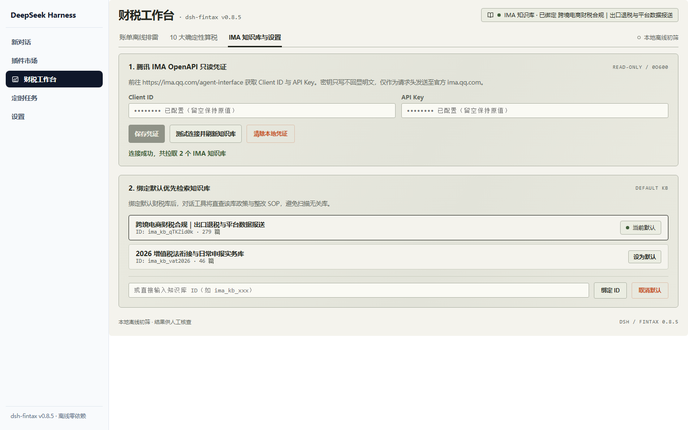

# dsh-fintax — 财税工作台 (v0.9.0)

[](https://www.npmjs.com/package/dsh-fintax)
[](https://github.com/fleekelon/dsh-fintax/actions/workflows/test.yml)
[](LICENSE)
[](https://github.com/topics/dsh-plugin)

**交互式 3D 官网与实景演示**：<https://fleekelon.github.io/fintax-portal/>


**一句话定位**：帮中国跨境卖家的财务在本机离线打通 **① 平台放款 → ② 结汇通道 → ③ 国内对公银行实收回单** 完整三段资金链，并把已对上的金额、银行扣费/汇损/在途差额、待补凭证与 **2026 Q1–Q4 年度三地交卷自检**，整理成一份能直接交给老板和会计的**月结/年度核对单**（默认纯洁无推广，纯 ESM，严格零第三方运行时与开发依赖，原始账单 100% 留在本机内存）。

- **左侧边栏独立可视化工作台（Braun 精密仪表风格 · 模块化零依赖构建 · 0 Token 本地运行）**：
  - 安装后在 DSH 左侧导航栏直接点击 **「财税工作台」**（兼容 **「设置 → 财税工作台」**、DSH `0.2.2` / `0.2.3` `conversation.input.dock` 特性探测与 `dsh-market` Update API v1 被动版本提示），无需配置 IMA 即可完成全流程核对与导出；
  - **Tab 1 · 17 通道离线对账雷达 & Stage 3 国内银行回单 5 键核销**：拖入销售账单、第三方结汇流水、国内对公银行回单或 `.xlsx`/`.xlsm`/`.zip` 原包（支持一键体验 **`demo:v9`** 完整三段资金链），自动执行 **Stage 1→2→3 fail-closed 5 键核销**（主体 + 对公账号/尾号 + 账期 + 参考号 + 币种金额），清晰拆分法定实收 CNY、银行手续费、结汇汇损、在途差额与独立隔离的 **`stage3CandidateMatches` 参考级候选**；解析结果进纯内存短生命周期缓存（`cacheToken`，严格绑定宿主已鉴别的独占会话身份、严禁落盘，缺失独占会话身份时安全回退 `cacheToken: null`），导出老板版 HTML / MD / 派活 CSV 走 `POST /api/fintax/parse/export` 免重传 20 MiB Base64（过期自动无感降级并刷新 `cacheToken`）。
  - **Tab 2 · 14 项确定性交互试算**：在原有 11 项引擎基础上，新增 **`eu_low_value_parcel`**（欧盟 `≤€150` 低值包裹 `€3`×HS 项数 + `€2`×HS 项数退货不退处理费 & PID 含税抽佣向上取分反推售价）、**`us_t86_vs_9810_ddp`**（美线 Type 11 直邮 vs 9810 海外仓 DDP + 2027 FBA `+$0.19` 敏感度 + IEEPA/CAPE fail-closed 退税严检与 `ACE ACH Hold` + `2027-01-05` FIOR/`CTPAT-validated` 红线）与 **`fba_mixed_procurement_split`**（FBA 有票+无票混合采购拆单三方案净收益对比）；`GET /api/fintax/calc/specs` 暴露全部 14 引擎规格注册表。
  - **Tab 3 · 年度汇算（Q1–Q4）与归档管理 (`dsh-fintax-history-v4`)**：按自然年与稳定 `entityKey` 汇总 Q1–Q4 季度走势、双边同覆盖期差额、缺失月份、跨主体防混算保护与 **全球三地报送自检卡**（中国 810 号令平台按季报送与卖家内部全年勾稽 / 欧盟 DAC7 平台报送 `2027-01-31` 与主管机关交换分期 `2027-02-28` / 美国 IRS 1099-K TPSO 联邦 `>$20,000` 且 `>200` 笔双门槛、支付卡收单另核、收款人联 `2027-02-01` 与电子报送 IRS `2027-03-31` + 州级更低门槛）；支持一键导出年度老板 HTML/MD 报表、「待认领」与历史归档主体重分配（改店名保留原 `entityKey`、`409` 版本/业务键冲突分流保护）及带强制 SHA-256 完整性防损校验（区别于密码学来源签名）与按 UUID 幂等合并的 JSON 备份导入/导出。
  - **工作台内置 IMA 轻检索侧抽屉 & 设置页（按需可选）**：异常行与算税结果支持「就地查 IMA 出处」，严格只读返回 3 字段纯文本 `{ title, folderPath, snippet }`（`≤160` 字摘要、剥离 URL/HTML/控制符，绝不透传内部 ID、原文或下载链接），一键带入 DSH 对话深入追问。
- **17 通道跨境账单 + 国内对公银行回单离线合并体检（`fintax_parse_statement`）**：
  - **11 大销售平台及收单网关**：**Amazon**（Date Range CSV / Flat File V2，新增 FR/IT/ES 本地化表头、`SE/PL/BE/TR/AE/SA/BR/IN/IE` 9 大站点与 2027 FBA 新费用科目识别）、**TikTok Shop**、**Temu**、**速卖通 AliExpress**、**Shopee**、**Shopify**、**PayPal**、**Stripe**，以及 `v0.9` 新增 **SHEIN**（全托管/半托管混表 P0 阻断与费用冲回保符号）、**Walmart**（官方长表事件流 + WFS 宽表）与 **Lazada**（Fee Name / VAT in Amount / Paid Status / WHT）；
  - **6 大第三方结汇通道**：**万里汇 WorldFirst**、**派安盈 Payoneer**、**空中云汇 Airwallex**，以及 `v0.9` 新增 **连连国际 LianLian**、**PingPong**、**寻汇 SUNRATE**（严守 `settlement_wallet` 独立轨绝不重复计税，自动识别内扣/外扣手续费、个人私户 P0、坐支 P1、退汇冲减与脱敏结汇凭证）；
  - **Stage 3 国内对公银行回单核销（`v0.9` 新增）**：支持招商银行、中国银行、工商银行、建设银行、农业银行、交通银行及通用对公银行电子回单解析，严守 fail-closed 5 键精确核销与非对公/私户 P0 阻断；
  - 支持 `.zip` 免解压直拖、`UTF-16` 及 **`demo:v9`** / `demo:v8` / `demo:wallets` / `demo:all` / `demo:v7` / `demo:full` 免文件沙盒；原生 `BigInt` 定点运算，50,000 行 Amazon 大账单百毫秒级解析。
- **14 大代码级确定性算税与差额桥接引擎（`fintax_calc`，免配 IMA 亦可离线使用）**：
  1. **四层口径桥接（`platform_tax_reconcile`）**；
  2. **欧盟低值包裹 `€3+€2` 与 PID 反推售价（`eu_low_value_parcel`，`v0.9` 新增）**：`€3 × HS 项数` 临时关税 + **`€2 × HS 项数` 退货不退处理费**（IOSS 不代收）、含税抽佣向上取分反推最低含税售价（含 `€150` 门槛复核）及直邮/拆包/欧盟仓对比；
  3. **美线 Type 11 直邮 vs 9810 海外仓 DDP 与 IEEPA/FIOR（`us_t86_vs_9810_ddp`，`v0.9` 新增）**：T86 暂停后双路径毛利与 `2027-01-15` FBA `+$0.19` 敏感度、IEEPA/CAPE 退税 fail-closed 严检（严拒 301/232/122 及超期）、`ACE ACH Hold` P0 告警与 `2027-01-05` FIOR + `CTPAT-validated` 清关红线；
  4. **FBA 有票+无票混合采购拆单（`fba_mixed_procurement_split`，`v0.9` 新增）**：硬混一票视同内销征税 vs 有票 0110 退税 + 无票 9810/9610/1039/合规代理拆单 vs 加点补票全走 0110；
  5. **退税取消/下调与电池消费税双税毛利冲击（`export_rebate_cancel_impact`）**（明确区分成品充电宝/成套储能不在电池消费税征税范围，2% 减征与新技术免征须有效 CMA 报告）；
  6. **供应商开票加点毛利临界测算（`export_invoice_breakeven`）**；
  7. **跨境出口退运（`cbec_return_duty_exempt`）**（2026 年第 16 号公告）；
  8. **生产企业出口“免、抵、退”税（`export_rebate_manufacturer`）**；
  9. **一般纳税人登记与增值税试算（`vat_taxpayer_threshold`）**（检查**严格超过 500 万元**登记标准与月 10 万/季 30 万起征点）；
  10. **综试区零售出口企业所得税与 300 万超崖对照（`cbec_assessed_cit`）**；
  11. **外贸企业出口免退税（`export_rebate`）**；
  12. **全年一次性奖金双轨比选与 6 盲区（`annual_bonus_iit`）**；
  13. **跨境电商零售进口综合税（`cross_border_import`）**；
  14. **增值税价税分离（`vat`）**。
- **政策引证问答 & 监管代码决策树**：只读检索你 IMA 知识库里的政策原文与 SOP，回答附真实来源与文号。

## 侧栏实机截图（v0.8.5）

以下截图采集自 `v0.8.5` 本地实机测试环境（`1440×900`）。

1. **DSH 侧边栏独立财税工作台（Braun 精密仪表风格）— 11 通道离线排雷、三段资金链交叉核对、12 个月双指针红线雷达与趋势月报**：


2. **0 Token 交互式 10 大确定性算税与四层口径差额桥接计算器**：


3. **免命令行图形化 IMA 知识库凭证与默认优先库绑定**：



## 安装（支持图形界面一键安装，无需命令行）

`dsh-fintax` 已收录至 [awesome-dsh-plugin](https://github.com/awesome-dsh-plugin/awesome-dsh-plugin) 与 [dsh-market](https://github.com/dsh-market/dsh-market) 插件市场目录：

### 方式一：DSH 桌面端图形界面一键安装（推荐，财务/老板零门槛）
- **原生插件管理**：打开官方 DSH Desktop 应用内的 **「设置 → 插件」**，直接搜索 **`dsh-fintax`** 点击安装即可，全程无需敲命令行；
- **可视化插件市场**：若已安装社区插件市场（`dshmarket`）或开启 **「插件 → 发现（Discover）」**，搜索 **「财税工作台」** 或 **`dsh-fintax`** 一键点装即可。

### 方式二：命令行安装（适用于 `dsh web` 或开发者自定义 Profile）

```sh
# 推荐：安装至 DSH 桌面端默认 Profile（desktop）
dsh plugin --profile desktop add dsh-fintax

# 从 GitHub 安装至自定义 Profile
dsh plugin --profile <你的profile> add github:fleekelon/dsh-fintax
```

兼容 DSH >= 0.2.1-rc.2（桌面端暗黑主题原生适配 `data-ds-dark-theme`）。

## 配置 IMA 知识库（可选，支持图形界面一键配置）

原始账单离线体检（`fintax_parse_statement`）与 14 项算税对账（`fintax_calc`）无需凭证。启用腾讯 IMA 知识库政策引证问答与工作台轻检索侧抽屉时，请按以下步骤配置。

1. 打开 <https://ima.qq.com/agent-interface> 获取 `Client ID` 与 `API Key`；
2. **推荐方式（图形界面）**：在 DSH 桌面端打开 **「设置 → 财税工作台」**，粘贴保存凭证，点击「测试连接并拉取知识库」即可点选绑定你的默认财税知识库；
3. **CLI / 环境变量方式**：写入 `~/.config/ima/client_id` 与 `~/.config/ima/api_key`（可选 `~/.config/ima/fintax_config.json`），或设置环境变量 `IMA_CLIENT_ID` / `IMA_API_KEY` / `IMA_DEFAULT_KB_ID`。

安全承诺：设置页接口逐请求执行宿主会话准入校验（`connection.admit`），密钥只写不回传明文，且仅作为请求头发送至官方 `https://ima.qq.com`（严格只读）；工作台 IMA 轻检索侧抽屉严格截断为 `≤160` 字纯摘要片段；`fintax_parse_statement` 仅在本机离线读取用户指定的账单文件，解析缓存纯驻内存严禁落盘。

## 工具与技能

| 工具 | 用途 |
|---|---|
| `fintax_parse_statement` | 本地离线解析 11 大销售平台（Amazon / TikTok Shop / Temu / 速卖通 / Shopee / Shopify / PayPal / Stripe / SHEIN / Walmart / Lazada）、6 大第三方结汇通道（万里汇 / 派安盈 / 空中云汇 / 连连国际 / PingPong / 寻汇）与国内对公银行回单及 `.zip` 包（支持 `demo:v9` / `demo:v8` / `demo:wallets` / `demo:all` / `demo:v7` / `demo:full`），自动执行 Stage 1–3 三段资金链 5 键核销（绝不重复计税）、输出异常雷达与可打印 HTML/MD 诊断书及排雷 CSV |
| `fintax_calc` | 14 场景确定性试算与对账：`platform_tax_reconcile` / `eu_low_value_parcel` / `us_t86_vs_9810_ddp` / `fba_mixed_procurement_split` / `export_rebate_cancel_impact` / `export_invoice_breakeven` / `cbec_return_duty_exempt` / `export_rebate_manufacturer` / `vat_taxpayer_threshold` / `cbec_assessed_cit` / `export_rebate` / `annual_bonus_iit` / `cross_border_import` / `vat` |
| `ima_list_kbs` | 列出你的 IMA 知识库并标识已绑定的默认优先库 |
| `ima_search` | 在默认或指定知识库内搜索政策原文与底稿。首屏长问题少于两条时，并发补查最多三组财税短词，去重后按命中频次融合 |
| `ima_browse` | 浏览默认或指定知识库目录及展开子文件夹 |
| `ima_read` | 按 `media_id` 读取 Markdown / 笔记原文（支持 `offset` 8,000 字分段续读） |

| 技能 | 触发场景 |
|---|---|
| `fintax-calc` | 17 通道原始账单与银行回单离线体检、14 项税额试算、三段资金核销与年度三地交卷自检工作流 |
| `fintax-policy-qa` | 政策引证问答（新旧文件优先级 + 降级路径） |
| `fintax-crossborder-check` | 跨境电商全链路合规自查报告（对齐 2026–2027 现行法规与三地报送） |
| `fintax-mode-select` | 海关监管代码、FBA 混合采购拆单与出口模式决策树 |

## 问题反馈与新渠道适配

- **提交新平台/结汇通道/银行回单脱敏表头**（例如更多欧洲/拉美本地站或城商行回单格式）：请前往 [GitHub Issue 表单](https://github.com/fleekelon/dsh-fintax/issues/new/choose) 选择 **「新平台 / 结汇通道脱敏表头提交」**，仅提供表头列名与 2 行虚构示例数据即可排期适配，切勿粘贴真实订单或账户隐私。
- **报告算税边界或账单误报**：同样可通过上述表单选择 **「算税口径 / 账单误报 Bug 反馈」** 提交脱敏复现步骤。

## 免责声明

本插件输出为财税初筛体检、算术试算与研究辅助，不构成正式关账底稿、税务申报依据或鉴证意见。企业月末正式关账与历史差异更正请结合多店铺完整底稿咨询执业税务师/律师，并以主管税务机关口径为准。

## License

MIT
