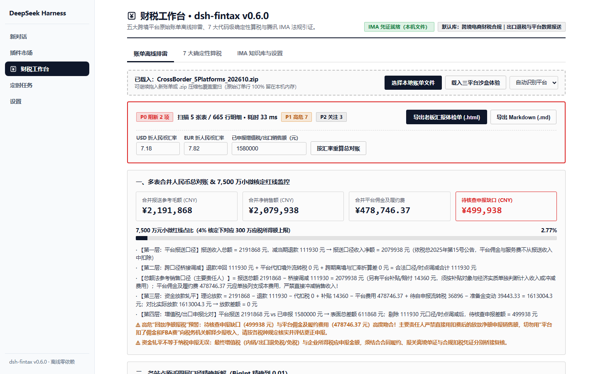
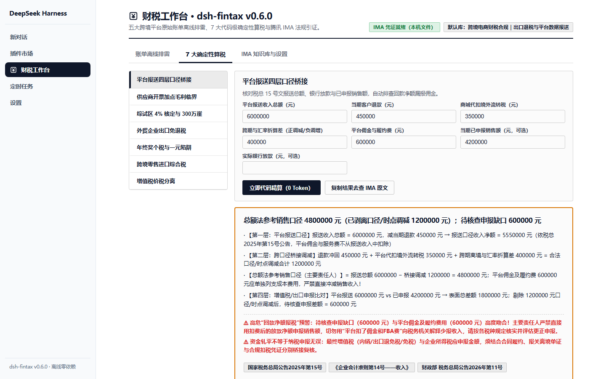

# dsh-fintax — 财税工作台 (v0.7.1)

[](https://www.npmjs.com/package/dsh-fintax)
[](https://github.com/fleekelon/dsh-fintax/actions/workflows/test.yml)
[](LICENSE)
[](https://github.com/topics/dsh-plugin)


DeepSeek Harness 财税插件，在 DSH 左侧边栏提供账单离线排雷、10 项确定性交互算税、12 个月滚动风险初筛、HTML 体检单与异常 CSV 导出，以及腾讯 IMA 只读法规检索。纯 ESM，零第三方运行时依赖。

- **左侧边栏独立可视化工作台（`v0.7` 进化为全年滚动风控工作台，0 Token 毫秒级响应）**：
  - 安装后在 DSH 左侧导航栏直接点击 **「财税工作台」**（同时兼容 **「设置 → 财税工作台」**），无需手写提示词、不消耗大模型 Token；
  - **Tab 1 · 账单离线排雷与滚动监控**。拖入多份账单或 `.zip` 原包，可归档月度汇总、按异常分级筛选并导出 HTML、Markdown 或 CSV。7,500 万是 4% 核定假设下的收入等值，500 万是一般纳税人登记参考值。两项均以账单推算的报送参考净额作初筛，正式测算需另核主体、纳税期间及对应税种数据。
  - **Tab 2 · 10 项交互试算**。表单覆盖对账、出口退（免）税、退运、纳税人登记、小型微利及基础税额计算。
  - **Tab 3 · IMA 知识库设置**：免命令行安全保存只读凭证、一键刷新并绑定默认优先库（内置 5xx 指数退避重试与 60s 只读目录缓存，深浅主题与窄屏响应式自适应）。
- **8 大跨境平台及资金池原始账单 / `.zip` 离线合并体检（`fintax_parse_statement`）**：
  - 支持原样导出的 **Amazon**（Date Range CSV / Flat File V2）、**TikTok Shop**（Statements 多表 `.xlsx`/`.csv`）、**Temu**（半托管/全托管）、**速卖通 AliExpress**（POP 自运营/Choice 全托管混表与 IOSS/VAT 拆分）、**Shopee 虾皮**（多工作表多币种、运费倒挂与预提税 WHT 预警）、**Shopify 独立站**、**PayPal 资金池**（自动剥离换汇流水防重复报税 + 余额坐支广告/争议预警）、**Stripe**，支持 `.zip` 免解压直拖、`UTF-16` 及 `demo:all` / `demo:v7` / `demo:full` 免文件沙盒；
  - 用原生 `BigInt` 对账单金额做定点运算，支持 `fx_rates` 多币种人民币折算。原始订单明细留在本机内存。
- **10 大代码级确定性算税与差额桥接引擎（`fintax_calc`，免配 IMA 亦可离线使用）**：
  1. **四层口径桥接（`platform_tax_reconcile`）**。对照平台报送、财务会计、增值税与出口、企业所得税。资金桥接单列，放款差额 = 实际放款 − 理论放款。申报比对差额 = 报送总额或调整后的参考额 − 已申报销售额。
  2. **供应商开票加点毛利临界测算（`export_invoice_breakeven`）**；
  3. **跨境出口退运（`cbec_return_duty_exempt`）**。核验 2026–2027 年申报的 9610/9710/9810/1210 批次、六个月期限、原状非食品、滞销或退货及退税缴回证明。1210 按出区离境日期起算并核对退回境内区外。专项资格未满足时另按普通复运规则核验。
  4. **生产企业出口“免、抵、退”税（`export_rebate_manufacturer`）**：五步法精算征退差转成本、应退税额、免抵税额（含城建附加税预警）与留抵结转；
  5. **一般纳税人登记与增值税试算（`vat_taxpayer_threshold`）**。检查 500 万登记标准与现行期限，估算进项抵扣临界点。小规模起征点按月 10 万、按季 30 万分别计算，等于起征点时按全额计税。
  6. **综试区零售出口企业所得税（`cbec_assessed_cit`）**。4% 应税所得率须经主管税务机关鉴定。小型微利实际税负 5% 的政策执行至 2027-12-31，由同一主体的年度应纳税所得额、从业人数、资产总额及行业条件共同决定。
  7. **外贸企业出口免退税（`export_rebate`）**；
  8. **全年一次性奖金单独计税个税（`annual_bonus_iit`）**；
  9. **跨境电商零售进口综合税（`cross_border_import`）**；
  10. **增值税价税分离（`vat`）**。
- **政策引证问答 & 监管代码决策树**：只读检索你 IMA 知识库里的政策原文与 SOP，回答附真实来源与文号。

## 实测效果与独立工作台实机截图（v0.7.1）

1. **DSH 侧边栏独立财税工作台（Braun 精密仪表风格）— 8 大平台原始账单 / `.zip` 拖拽排雷、12 个月双指针红线雷达与异常 CSV 导出**：



2. **0 Token 交互式 10 大确定性算税与四层口径差额桥接计算器**：



3. **免命令行图形化 IMA 知识库凭证与默认优先库绑定**：


## 安装（支持图形界面一键安装，无需命令行）

`dsh-fintax` 已收录至 [awesome-dsh-plugin](https://github.com/awesome-dsh-plugin/awesome-dsh-plugin) 与 [dsh-market](https://github.com/dsh-market/dsh-market) 插件市场目录：

### 方式一：DSH 桌面端图形界面一键安装（推荐，财务/老板零门槛）
- **原生插件管理**：打开官方 DSH Desktop 应用内的 **「设置 → 插件」**，直接搜索 **`dsh-fintax`** 点击安装即可，全程无需敲命令行；
- **可视化插件市场**：若已安装社区插件市场（`dshmarket`）或开启 **「插件 → 发现（Discover）」**，搜索 **「财税工作台」** 或 **`dsh-fintax`** 一键点装即可。

### 方式二：命令行安装（适用于 `dsh web` 或开发者自定义 Profile）

```sh
# 从 npm 安装最新版（预构建免授权）
dsh plugin --profile <你的profile> add dsh-fintax

# 从 GitHub 安装
dsh plugin --profile <你的profile> add github:fleekelon/dsh-fintax
```

兼容 DSH >= 0.2.1-rc.2。

## 配置 IMA 知识库（可选，支持图形界面一键配置）

原始账单离线体检（`fintax_parse_statement`）与 10 项算税对账（`fintax_calc`）无需凭证。启用腾讯 IMA 知识库政策引证问答时，请按以下步骤配置。

1. 打开 <https://ima.qq.com/agent-interface> 获取 `Client ID` 与 `API Key`；
2. **推荐方式（图形界面）**：在 DSH 桌面端打开 **「设置 → 财税工作台」**，粘贴保存凭证，点击「测试连接并拉取知识库」即可点选绑定你的默认财税知识库；
3. **CLI / 环境变量方式**：写入 `~/.config/ima/client_id` 与 `~/.config/ima/api_key`（可选 `~/.config/ima/fintax_config.json`），或设置环境变量 `IMA_CLIENT_ID` / `IMA_API_KEY` / `IMA_DEFAULT_KB_ID`。

安全承诺：设置页接口逐请求执行宿主会话准入校验（`connection.admit`），密钥只写不回传明文，且仅作为请求头发送至官方 `https://ima.qq.com`（严格只读）；`fintax_parse_statement` 仅在本机离线读取用户指定的账单文件。

## 工具与技能

| 工具 | 用途 |
|---|---|
| `fintax_parse_statement` | 本地离线解析 8 大跨境平台及资金池（Amazon / TikTok Shop / Temu / 速卖通 AliExpress / Shopee / Shopify / PayPal / Stripe）原始账单及 `.zip` 包（支持 `demo:all` / `demo:v7` / `demo:full` 免文件体验），输出多币种合并对账、异常雷达与可打印 HTML/MD 诊断书及排雷清单 CSV |
| `fintax_calc` | 10 场景确定性试算与对账：`platform_tax_reconcile` / `export_invoice_breakeven` / `cbec_return_duty_exempt` / `export_rebate_manufacturer` / `vat_taxpayer_threshold` / `cbec_assessed_cit` / `export_rebate` / `annual_bonus_iit` / `cross_border_import` / `vat` |
| `ima_list_kbs` | 列出你的 IMA 知识库并标识已绑定的默认优先库 |
| `ima_search` | 在默认或指定知识库内搜索政策原文与底稿。首屏长问题少于两条时，并发补查最多三组财税短词，去重后按命中频次融合 |
| `ima_browse` | 浏览默认或指定知识库目录及展开子文件夹 |
| `ima_read` | 按 `media_id` 读取 Markdown / 笔记原文 |

| 技能 | 触发场景 |
|---|---|
| `fintax-calc` | 原始账单离线体检、税额试算与四层口径差额桥接工作流 |
| `fintax-policy-qa` | 政策引证问答（新旧文件优先级 + 降级路径） |
| `fintax-crossborder-check` | 跨境电商全链路合规自查报告（对齐 2026 现行法规） |
| `fintax-mode-select` | 海关监管代码与出口模式决策树 |

## 免责声明

本插件输出为财税初筛体检、算术试算与研究辅助，不构成正式关账底稿、税务申报依据或鉴证意见。企业月末正式关账与历史差异更正请结合多店铺完整底稿咨询执业税务师/律师，并以主管税务机关口径为准。

## License

MIT
